# Práctica No. 3 – Crear volúmenes para persistir bases de datos con PostgreSQL y Docker

**Asignatura:** Tendencias Tecnológicas · **Semana:** 3  
**Estudiante:** Pablo Ortega · **Carrera:** Desarrollo de Software  
**Instituto:** Sudamericano · **Fecha:** 26 de octubre de 2026 (Ecuador, UTC−5)

## 1. Título

Crear volúmenes para persistir bases de datos con PostgreSQL 16 y Docker, comparando una instancia con almacenamiento nuevo y otra que reutiliza el volumen `pgdata`.

## 2. Tiempo de duración

Se registraron aproximadamente **16.2 minutos** de preparación, ejecución y documentación hasta guardar esta versión del informe. El ensayo final que muestran las capturas duró **44.46 segundos (0.74 minutos)**, entre las 21:24:15 y las 21:24:59 de Ecuador. La primera ejecución, que incluyó descargar la imagen, tomó 114,58 segundos. Las marcas exactas del ensayo fotografiado constan en [resultados.json](evidencias/resultados.json).

## 3. Fundamentos

Docker permite distribuir y ejecutar aplicaciones en contenedores. En esta práctica lo utilicé para iniciar PostgreSQL sin instalar su servidor directamente en Windows. Un contenedor es un proceso aislado con su entorno de ejecución; puede iniciarse, detenerse y sustituirse de manera independiente. Los contenedores Linux comparten el núcleo del entorno Linux donde corre el motor. Docker Desktop proporciona ese entorno en Windows mediante WSL 2. Esta organización simplifica las pruebas, aunque sigue siendo necesario controlar puertos, credenciales y almacenamiento (Docker, s. f.-d; Docker, s. f.-a).

Una imagen es el paquete base a partir del cual se crean contenedores. Contiene programas, bibliotecas y configuraciones. Usé la imagen oficial `postgres:16`: la etiqueta identifica la versión principal solicitada, mientras que el digest registrado identifica el contenido concreto descargado. Crear dos contenedores desde esa imagen no significa que compartan automáticamente los cambios de sus bases de datos. La imagen aporta el programa; los datos del servidor deben conservarse en un almacenamiento que pueda recuperarse después (Docker, s. f.-e).

PostgreSQL es un sistema de gestión de bases de datos relacional. Una base agrupa objetos como tablas, y una tabla almacena filas organizadas en columnas. En `test.customer`, la columna `id` identifica cada fila mediante una clave primaria; `fullname` contiene el nombre y `status` expresa su estado. Utilicé `CREATE DATABASE` y `CREATE TABLE` para definir la estructura, `INSERT` para guardar dos registros ficticios y `SELECT` para leerlos. El cliente `psql` permitió enviar estas instrucciones y observar las respuestas del servidor (PostgreSQL Global Development Group, s. f.-a, s. f.-b, s. f.-c, s. f.-d).

La persistencia significa que los datos continúan disponibles tras sustituir el proceso o el contenedor que los utiliza. Docker ofrece volúmenes para desacoplar su almacenamiento del ciclo de vida del contenedor. Un volumen con nombre, como `pgdata`, puede identificarse y montarse explícitamente en un contenedor nuevo. Para PostgreSQL 16, la ruta utilizada fue `/var/lib/postgresql/data` (Docker, s. f.-c; Docker Official Images, s. f.).

La comparación requiere una precisión: la imagen oficial puede crear un volumen anónimo aunque no se escriba `--mount`. En la primera prueba se generó otro volumen anónimo al recrear el contenedor; por eso la base anterior no apareció en la nueva instancia. El volumen previo no fue eliminado. En la segunda prueba se montó el mismo `pgdata`, por lo que PostgreSQL encontró su base y los dos clientes. Persistir tampoco equivale a tener una copia de seguridad: si se modifica o elimina información dentro del volumen, ese cambio también permanece. Por eso el aprendizaje central consiste en decidir y verificar qué almacenamiento se reutiliza, además de comprobar las consultas finales.

<figure>
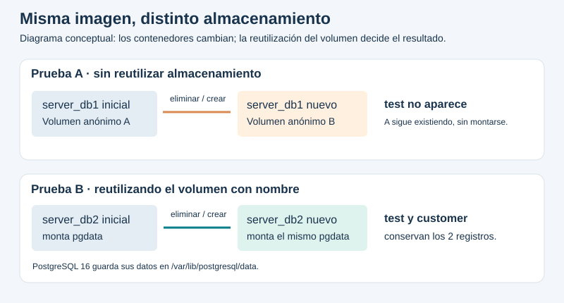
<figcaption>Figura 1. Comparación conceptual del almacenamiento en las dos pruebas. Diagrama de elaboración propia; no representa una captura de pantalla.</figcaption>
</figure>

## 4. Conocimientos previos

- Diferenciar una imagen, un contenedor y un volumen.
- Utilizar una terminal y distinguir comandos Docker de sentencias SQL.
- Comprender puertos locales y la conexión entre cliente y servidor.
- Conocer bases de datos, tablas, claves primarias, INSERT y SELECT.
- Interpretar la salida de un comando y un error esperado como parte de una comprobación.

## 5. Objetivos a alcanzar

- Ejecutar PostgreSQL 16 mediante Docker y administrar una base con psql.
- Crear `test.customer`, insertar dos filas y comprobarlas con SELECT.
- Demostrar que una instancia nueva no recupera un almacenamiento que no se monta.
- Conservar datos al eliminar y recrear un contenedor con el mismo volumen `pgdata`.
- Registrar evidencias auténticas, proteger la contraseña local y conservar recursos ajenos.

## 6. Equipo necesario

- Computadora con Windows 11, Ubuntu 24.04.4 LTS en WSL 2 y Docker Desktop iniciado.
- Docker CLI y Engine 29.4.1; imagen oficial `postgres:16` y cliente `psql` incluido en ella.
- PowerShell y Python 3.10 para automatizar y registrar la ejecución; Pillow para capturar la consola.
- Visual Studio Code para revisar Markdown y SQL; pgAdmin 4 para las consultas gráficas; Git y una cuenta de GitHub para entregar el repositorio.
- Dos puertos locales disponibles: 5433 y 5434 en esta ejecución.

## 7. Material de apoyo

- [Plantilla de informe del docente](https://github.com/maguaman2/informe-tendencias/blob/main/informe.md), revisada antes de redactar.
- [Documentación oficial de la imagen PostgreSQL](https://hub.docker.com/_/postgres).
- [Docker: volúmenes](https://docs.docker.com/engine/storage/volumes/) y [eliminación de contenedores](https://docs.docker.com/reference/cli/docker/container/rm/).
- [Manual de psql para PostgreSQL 16](https://www.postgresql.org/docs/16/app-psql.html) y tutorial SQL de la misma versión.
- Archivos SQL, script de ejecución y registros originales incluidos en este repositorio.

## 8. Procedimiento

### 8.1. Preparación y controles

La carpeta del proyecto se creó en `C:\Users\pablo\practica_postgresql_volumenes`. Docker Desktop estaba detenido y se inició. Se comprobó Ubuntu por WSL y luego el motor Docker. Antes de utilizar los nombres solicitados se verificó que no correspondieran a contenedores ni volúmenes anteriores. Se añadieron etiquetas a los recursos del ejercicio y sólo se permitió detener o eliminar contenedores con esa etiqueta.

La contraseña local se generó y guardó en `.env.local`, excluido por `.gitignore`; no se imprime en los comandos, capturas ni documentos públicos. El script utiliza `--env-file .env.local`. El archivo `.env.example` sólo contiene el nombre de la variable sin un valor secreto. La conexión a PostgreSQL se hizo mediante el administrador de consola **psql** incluido en la imagen, ejecutado con `docker exec`.

Los puertos se vincularon a `127.0.0.1`, limitando su publicación al equipo local. En `psql`, `-X` evita configuraciones personales, `-v ON_ERROR_STOP=1` detiene el procesamiento de SQL ante errores y `-P pager=off` muestra las salidas completas. La opción `-i` de `docker exec` transmite los archivos SQL por entrada estándar. `pg_isready -h 127.0.0.1` comprueba que el servidor definitivo ya escucha por TCP antes de consultar.

**Nota de trazabilidad:** se ejecutó un primer ensayo completo y correcto. Se repitieron únicamente los datos ficticios de este proyecto para corregir el tamaño de las capturas. Antes de repetir se respaldó esa base de demostración, se retiraron sus contenedores etiquetados y se vació exclusivamente su base `test`; se conservó el volumen `pgdata`. Ningún recurso anterior ajeno fue eliminado ni alterado. El ensayo fotografiado creó sus tablas antes de las pruebas de eliminación y no las recreó después. La creación original de `pgdata` se conserva en un registro adicional.

Las primeras 14 capturas se obtuvieron de la consola **durante la ejecución automatizada**. Se añadieron dos capturas directas de consultas ejecutadas en pgAdmin 4. Sólo se recortó el marco de la ventana para excluir el escritorio; las instrucciones y salidas no se modificaron. Cada imagen mide menos de 800 píxeles de ancho y tiene una transcripción `.txt` asociada. Todos los comandos y las entradas SQL del ensayo están en [comandos-ejecutados.json](evidencias/comandos-ejecutados.json).

### 8.2. Verificación de Docker y Ubuntu

Docker Desktop se inició y respondió con cliente y servidor 29.4.1. Ubuntu 24.04.4 LTS ejecutó comandos sobre el núcleo WSL 2. Las operaciones Docker se realizaron desde Windows; también se comprobó el acceso al motor desde Ubuntu. Se eligieron los puertos locales libres 5433 y 5434.

**Comandos ejecutados por el script (representación Windows):**

```text
docker version --format "Cliente={{.Client.Version}} Servidor={{.Server.Version}}"
docker info --format "Motor={{.OSType}} / {{.OperatingSystem}}"
wsl -d Ubuntu -- head -n 3 /etc/os-release
wsl -d Ubuntu -- uname -r
```

<figure>
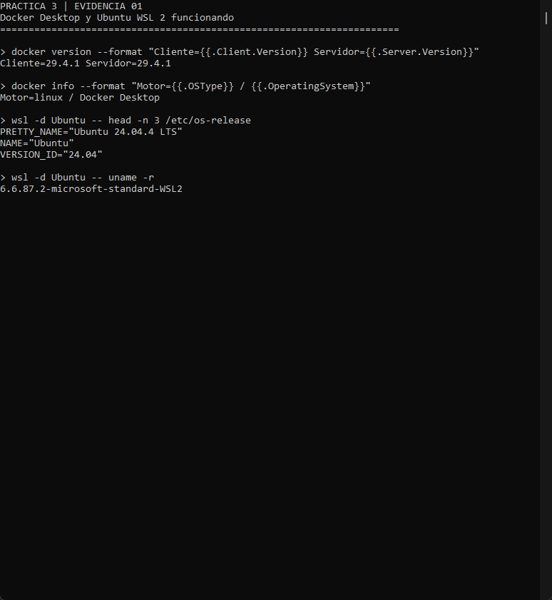
<figcaption>Figura 2. Verificación de Docker y Ubuntu. Captura propia de una ejecución real.</figcaption>
</figure>

[Salida completa de esta etapa](evidencias/01-docker-ubuntu.txt).

### 8.3. Imagen oficial postgres:16

En el primer ensayo la imagen no estaba disponible y se ejecutó `docker pull postgres:16`. En el ensayo fotografiado ya estaba descargada y se inspeccionó. `docker image inspect` registró el digest y confirmó que la imagen declara un volumen en `/var/lib/postgresql/data`.

**Comandos ejecutados por el script (representación Windows):**

```text
docker image inspect postgres:16 --format "{{index .RepoDigests 0}}"
docker image inspect postgres:16 --format "{{json .Config.Volumes}}"
```

<figure>
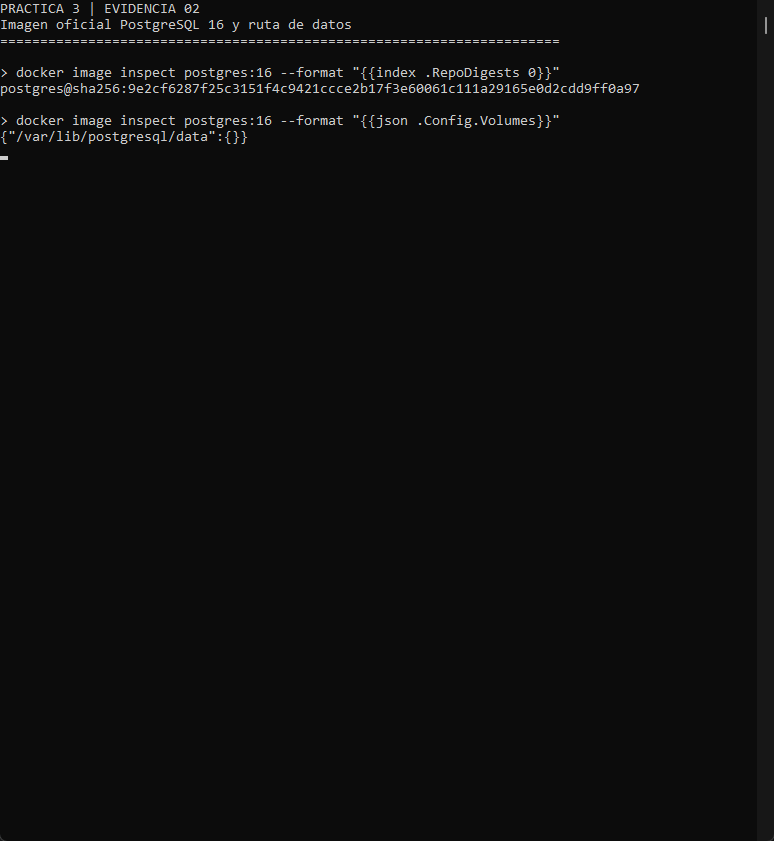
<figcaption>Figura 3. Imagen oficial postgres:16. Captura propia de una ejecución real.</figcaption>
</figure>

[Salida completa de esta etapa](evidencias/02-imagen-postgres.txt).

### 8.4. Creación del primer contenedor

`docker run -d` creó `server_db1` y devolvió su identificador. No se pasó un montaje reutilizable. Se publicó únicamente `127.0.0.1:5433`, y `pg_isready` confirmó que PostgreSQL aceptaba conexiones. `docker inspect` mostró el volumen anónimo que la imagen añadió automáticamente.

**Comandos ejecutados por el script (representación Windows):**

```text
docker run -d --name server_db1 --label edu.practica=postgresql-volumenes-semana3-pablo-ortega --env-file .env.local -p 127.0.0.1:5433:5432 postgres:16
docker exec server_db1 pg_isready -h 127.0.0.1 -U postgres
docker inspect server_db1 --format "{{range .Mounts}}{{println .Type .Name .Destination}}{{end}}"
```

<figure>
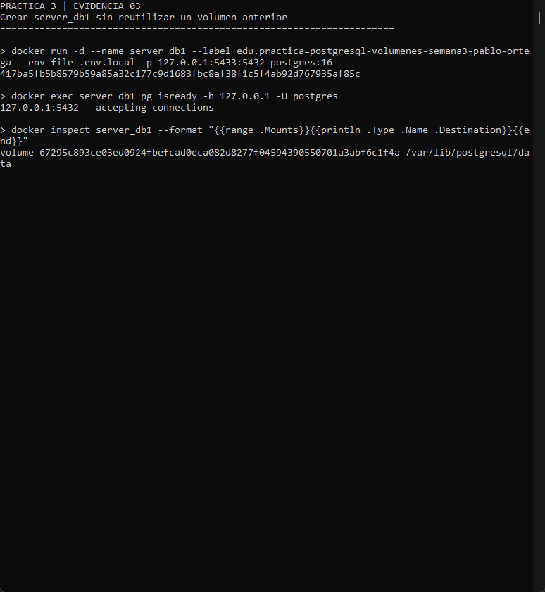
<figcaption>Figura 4. Creación del primer contenedor. Captura propia de una ejecución real.</figcaption>
</figure>

[Salida completa de esta etapa](evidencias/03-server-db1.txt).

### 8.5. Base test y tabla customer en server_db1

Con `docker exec -i` se ejecutó `psql` dentro del contenedor y se enviaron los archivos SQL por entrada estándar. Se crearon `test` y `customer`. La clave primaria usa una identidad numérica; `fullname` no admite nulos y `status` sólo admite activo o inactivo. La orden `\d customer` confirmó la definición.

**Comandos ejecutados por el script (representación Windows):**

```text
docker exec -i server_db1 psql -X -v ON_ERROR_STOP=1 -P pager=off -U postgres -d postgres
docker exec -i server_db1 psql -X -v ON_ERROR_STOP=1 -P pager=off -U postgres -d test
docker exec server_db1 psql -X -v ON_ERROR_STOP=1 -P pager=off -U postgres -d test -c "\d customer"
```

**SQL transmitido al servidor:**

```sql
CREATE DATABASE test;

CREATE TABLE customer (
    id INTEGER GENERATED ALWAYS AS IDENTITY PRIMARY KEY,
    fullname VARCHAR(120) NOT NULL,
    status VARCHAR(20) NOT NULL CHECK (status IN ('activo', 'inactivo'))
);
```

<figure>

<figcaption>Figura 5. Base test y tabla customer en server_db1. Captura propia de una ejecución real.</figcaption>
</figure>

[Salida completa de esta etapa](evidencias/04-base-tabla-db1.txt).

### 8.6. Inserción y SELECT en el primer contenedor

Se insertaron dos clientes ficticios y PostgreSQL respondió `INSERT 0 2`. La consulta ordenada por `id` devolvió las dos filas. Esta consulta fue el punto de comparación antes de sustituir el contenedor.

**Comandos ejecutados por el script (representación Windows):**

```text
docker exec -i server_db1 psql -X -v ON_ERROR_STOP=1 -P pager=off -U postgres -d test
docker exec -i server_db1 psql -X -v ON_ERROR_STOP=1 -P pager=off -U postgres -d test
```

**SQL de inserción y consulta:**

```sql
INSERT INTO customer (fullname, status) VALUES
    ('Cliente de demostracion', 'activo'),
    ('Cliente secundario', 'inactivo');

SELECT id, fullname, status FROM customer ORDER BY id;
```

<figure>
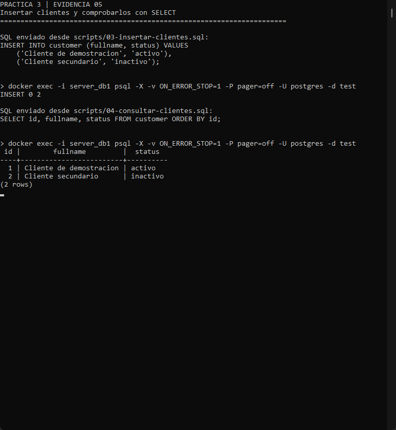
<figcaption>Figura 6. Inserción y SELECT en el primer contenedor. Captura propia de una ejecución real.</figcaption>
</figure>

[Salida completa de esta etapa](evidencias/05-registros-db1.txt).

### 8.7. Eliminación y recreación del primer contenedor

Después de comprobar la etiqueta de propiedad, `docker stop server_db1` detuvo el servidor y `docker rm server_db1` eliminó únicamente ese contenedor. No se usó `-v`. Se creó otro contenedor con el mismo nombre y puerto, sin montar el volumen anónimo previo.

**Comandos ejecutados por el script (representación Windows):**

```text
docker stop server_db1
docker rm server_db1
docker run -d --name server_db1 --label edu.practica=postgresql-volumenes-semana3-pablo-ortega --env-file .env.local -p 127.0.0.1:5433:5432 postgres:16
docker exec server_db1 pg_isready -h 127.0.0.1 -U postgres
```

<figure>
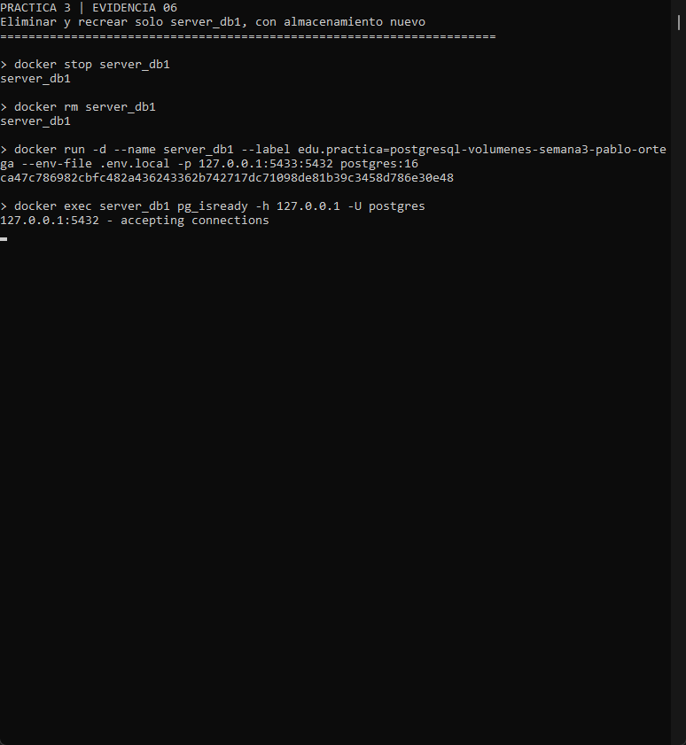
<figcaption>Figura 7. Eliminación y recreación del primer contenedor. Captura propia de una ejecución real.</figcaption>
</figure>

[Salida completa de esta etapa](evidencias/06-recrear-db1.txt).

### 8.8. Comprobación de que test no se recuperó

La consulta a `pg_database` devolvió cero filas y `test_disponible` fue `f`. Un intento de conexión a `test` terminó con el error esperado de base inexistente (código de salida 2). También se verificó que el volumen anónimo anterior seguía existiendo y que el contenedor nuevo tenía otro volumen. Este error esperado forma parte de una prueba exitosa.

**Comandos ejecutados por el script (representación Windows):**

```text
docker exec -i server_db1 psql -X -v ON_ERROR_STOP=1 -P pager=off -U postgres -d postgres
docker exec server_db1 psql -X -U postgres -d test -c "SELECT 1;"
docker volume inspect 67295c893ce03ed0924fbefcad0eca082d8277f04594390550701a3abf6c1f4a --format "Volumen anterior conservado: {{.Name}}"
docker inspect server_db1 --format "Volumen del contenedor nuevo: {{range .Mounts}}{{.Name}}{{end}}"
```

**Comprobación del catálogo:**

```sql
SELECT datname FROM pg_database WHERE datname = 'test';
SELECT EXISTS (SELECT 1 FROM pg_database WHERE datname = 'test') AS test_disponible;
```

<figure>
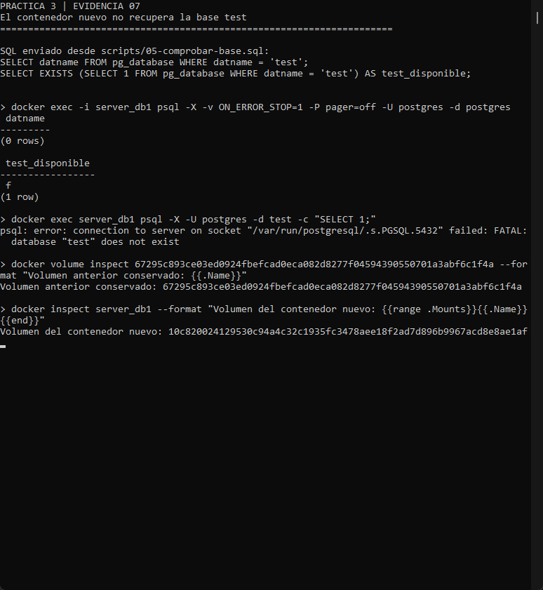
<figcaption>Figura 8. Comprobación de que test no se recuperó. Captura propia de una ejecución real.</figcaption>
</figure>

[Salida completa de esta etapa](evidencias/07-test-no-disponible.txt).

### 8.9. Volumen con nombre pgdata

`docker volume create` creó `pgdata` durante el primer ensayo, cuya salida se conserva en `evidencias/creacion-original-pgdata.txt`. Se mantuvo ese volumen durante la repetición para corregir las capturas. En la figura, el mismo comando es idempotente: devuelve el volumen propio ya existente; `docker volume inspect` confirma nombre y controlador. No se eliminó pgdata.

**Comandos ejecutados por el script (representación Windows):**

```text
docker volume create --label edu.practica=postgresql-volumenes-semana3-pablo-ortega pgdata
docker volume inspect pgdata --format "Nombre={{.Name}} Controlador={{.Driver}}"
```

<figure>
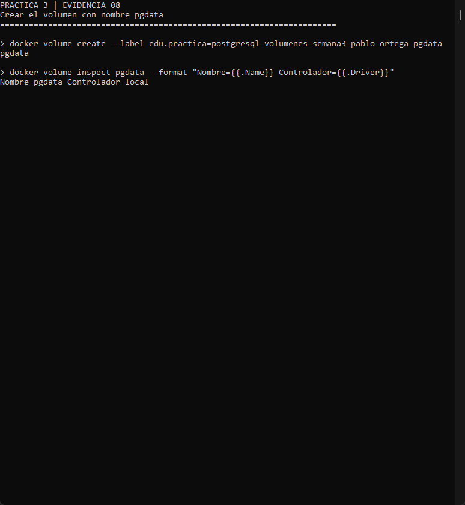
<figcaption>Figura 9. Volumen con nombre pgdata. Captura propia de una ejecución real.</figcaption>
</figure>

[Salida completa de esta etapa](evidencias/08-volumen-pgdata.txt).

### 8.10. Contenedor server_db2 con montaje persistente

Se creó `server_db2` en el puerto local 5434 utilizando `--mount type=volume,source=pgdata,target=/var/lib/postgresql/data`. La inspección confirmó que la ruta de datos apuntaba exactamente a `pgdata`.

**Comandos ejecutados por el script (representación Windows):**

```text
docker run -d --name server_db2 --label edu.practica=postgresql-volumenes-semana3-pablo-ortega --env-file .env.local -p 127.0.0.1:5434:5432 --mount type=volume,source=pgdata,target=/var/lib/postgresql/data postgres:16
docker exec server_db2 pg_isready -h 127.0.0.1 -U postgres
docker inspect server_db2 --format "{{range .Mounts}}{{println .Type .Name .Destination}}{{end}}"
```

<figure>
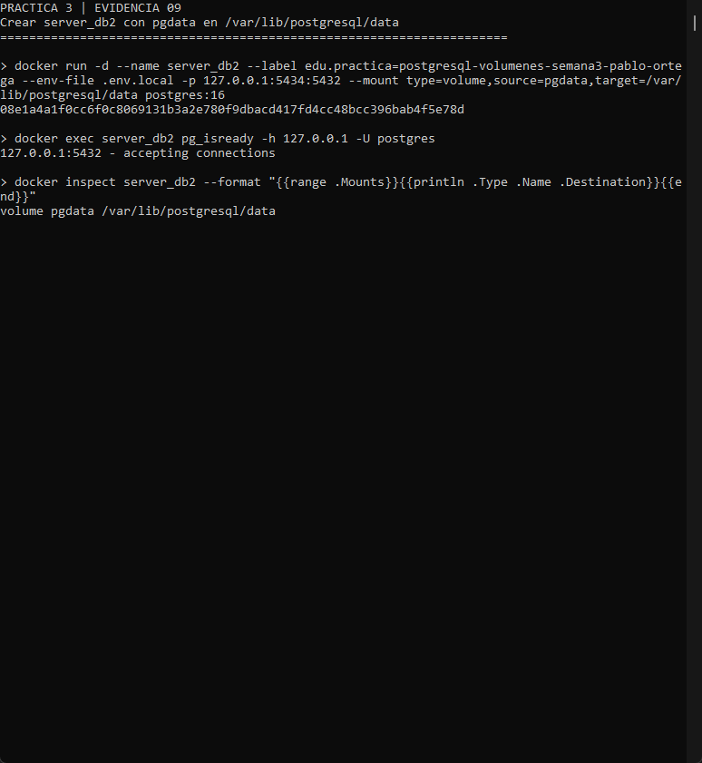
<figcaption>Figura 10. Contenedor server_db2 con montaje persistente. Captura propia de una ejecución real.</figcaption>
</figure>

[Salida completa de esta etapa](evidencias/09-server-db2.txt).

### 8.11. Base y tabla en el contenedor persistente

Se creó la base `test` y la tabla `customer` con los mismos archivos SQL. Esas operaciones se realizaron antes de eliminar el contenedor. No se volvió a crear el esquema entre su eliminación y la consulta final.

**Comandos ejecutados por el script (representación Windows):**

```text
docker exec -i server_db2 psql -X -v ON_ERROR_STOP=1 -P pager=off -U postgres -d postgres
docker exec -i server_db2 psql -X -v ON_ERROR_STOP=1 -P pager=off -U postgres -d test
docker exec server_db2 psql -X -v ON_ERROR_STOP=1 -P pager=off -U postgres -d test -c "\d customer"
```

**SQL transmitido al servidor:**

```sql
CREATE DATABASE test;

CREATE TABLE customer (
    id INTEGER GENERATED ALWAYS AS IDENTITY PRIMARY KEY,
    fullname VARCHAR(120) NOT NULL,
    status VARCHAR(20) NOT NULL CHECK (status IN ('activo', 'inactivo'))
);
```

<figure>
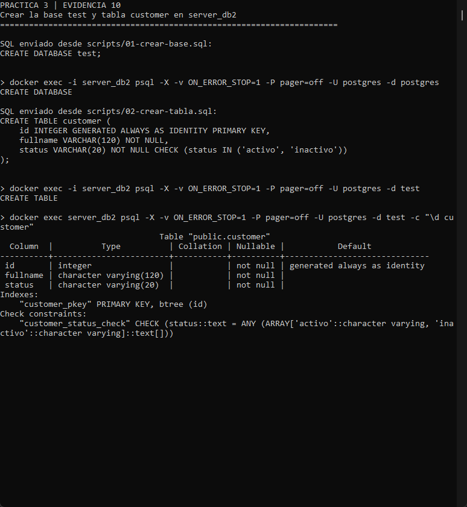
<figcaption>Figura 11. Base y tabla en el contenedor persistente. Captura propia de una ejecución real.</figcaption>
</figure>

[Salida completa de esta etapa](evidencias/10-base-tabla-db2.txt).

### 8.12. Registros guardados en pgdata

Se insertaron y consultaron dos registros. Se guardó una representación ordenada de las filas y el identificador del clúster para contrastarlos con el servidor recreado.

**Comandos ejecutados por el script (representación Windows):**

```text
docker exec -i server_db2 psql -X -v ON_ERROR_STOP=1 -P pager=off -U postgres -d test
docker exec -i server_db2 psql -X -v ON_ERROR_STOP=1 -P pager=off -U postgres -d test
```

**SQL de inserción y consulta:**

```sql
INSERT INTO customer (fullname, status) VALUES
    ('Cliente de demostracion', 'activo'),
    ('Cliente secundario', 'inactivo');

SELECT id, fullname, status FROM customer ORDER BY id;
```

<figure>
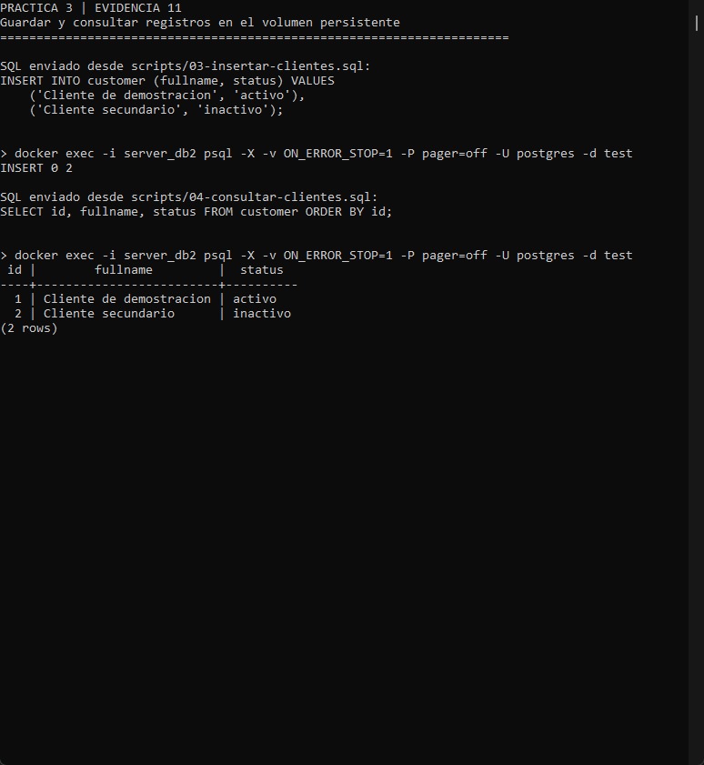
<figcaption>Figura 12. Registros guardados en pgdata. Captura propia de una ejecución real.</figcaption>
</figure>

[Salida completa de esta etapa](evidencias/11-registros-db2.txt).

### 8.13. Recreación del segundo contenedor sin eliminar pgdata

Se detuvo y eliminó solamente `server_db2`. `docker volume inspect pgdata` demostró que el volumen continuaba disponible. El contenedor se creó de nuevo con el mismo montaje y el mismo puerto.

**Comandos ejecutados por el script (representación Windows):**

```text
docker stop server_db2
docker rm server_db2
docker volume inspect pgdata --format "El volumen sigue disponible: {{.Name}}"
docker run -d --name server_db2 --label edu.practica=postgresql-volumenes-semana3-pablo-ortega --env-file .env.local -p 127.0.0.1:5434:5432 --mount type=volume,source=pgdata,target=/var/lib/postgresql/data postgres:16
docker exec server_db2 pg_isready -h 127.0.0.1 -U postgres
```

<figure>
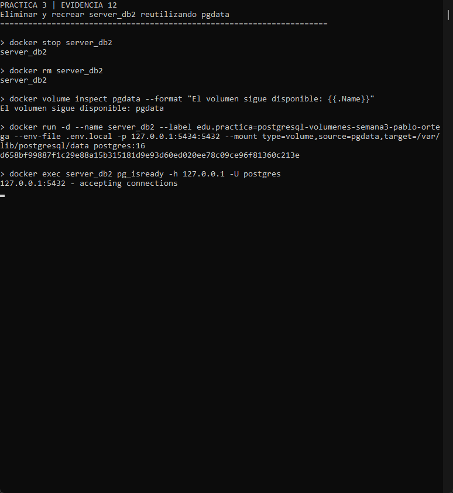
<figcaption>Figura 13. Recreación del segundo contenedor sin eliminar pgdata. Captura propia de una ejecución real.</figcaption>
</figure>

[Salida completa de esta etapa](evidencias/12-recrear-db2.txt).

### 8.14. Consulta que demuestra persistencia

Después de la recreación, `test_disponible` fue `t` y el SELECT devolvió los mismos dos clientes. Se verificaron la igualdad de las filas, el mismo identificador del clúster y el montaje de `pgdata`. El identificador del contenedor sí cambió. Así se descarta que el resultado sea simplemente un reinicio del mismo contenedor.

**Comandos ejecutados por el script (representación Windows):**

```text
docker exec -i server_db2 psql -X -v ON_ERROR_STOP=1 -P pager=off -U postgres -d postgres
docker exec -i server_db2 psql -X -v ON_ERROR_STOP=1 -P pager=off -U postgres -d test
```

**Comprobación del catálogo:**

```sql
SELECT datname FROM pg_database WHERE datname = 'test';
SELECT EXISTS (SELECT 1 FROM pg_database WHERE datname = 'test') AS test_disponible;
```

<figure>
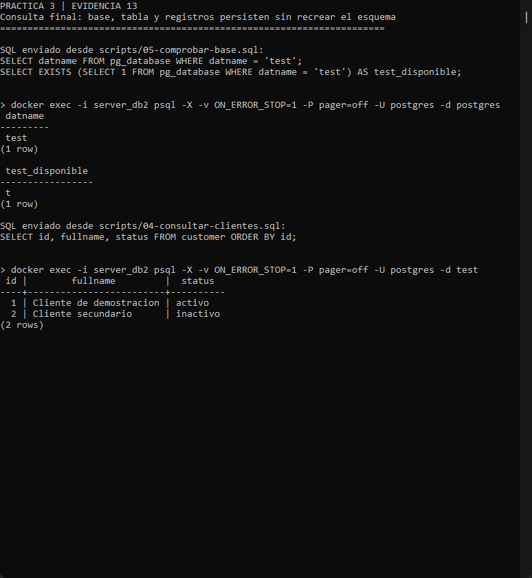
<figcaption>Figura 14. Consulta que demuestra persistencia. Captura propia de una ejecución real.</figcaption>
</figure>

[Salida completa de esta etapa](evidencias/13-persistencia-verificada.txt).

### 8.15. Estado final de los recursos de la práctica

`docker ps` filtrado por etiqueta mostró ambos contenedores en ejecución. `docker volume ls` e `inspect` confirmaron que `pgdata` permanece disponible y montado en server_db2. Las verificaciones también comprobaron que los identificadores de los contenedores previos al trabajo continúan existiendo.

**Comandos ejecutados por el script (representación Windows):**

```text
docker ps --filter label=edu.practica=postgresql-volumenes-semana3-pablo-ortega --format "table {{.Names}}	{{.Image}}	{{.Status}}	{{.Ports}}"
docker volume ls --filter label=edu.practica=postgresql-volumenes-semana3-pablo-ortega --format "table {{.Name}}	{{.Driver}}"
docker inspect server_db2 --format "{{range .Mounts}}{{println .Name \"->\" .Destination}}{{end}}"
```

<figure>
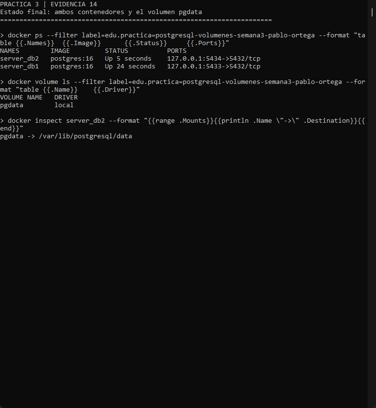
<figcaption>Figura 15. Estado final de los recursos de la práctica. Captura propia de una ejecución real.</figcaption>
</figure>

[Salida completa de esta etapa](evidencias/14-estado-final.txt).

### 8.16. Comprobaciones gráficas con pgAdmin 4

Después de las pruebas automatizadas se conectó el administrador gráfico pgAdmin 4 a ambos servidores. Se utilizó una configuración aislada en la carpeta local de esta práctica para conservar los ajustes anteriores de la aplicación. Las conexiones usaron `127.0.0.1`, puertos 5433 y 5434, usuario `postgres` y la contraseña local, que no aparece en las imágenes. El registro de instrucciones para repetir esas conexiones está en [conectar-pgadmin.md](scripts/conectar-pgadmin.md).

En Query Tool del primer servidor se consultó `pg_database`: `test_disponible` devolvió `false`. En el segundo, el SELECT a `test.customer` devolvió los mismos dos clientes. Fueron consultas nuevas ejecutadas contra los contenedores finales, no imágenes de resultados simulados. El editor SQL y el panel Data Output permiten observar la instrucción y su respuesta en una sola pantalla (pgAdmin Development Team, s. f.).

```sql
-- server_db1: conectado a postgres
SELECT EXISTS (
    SELECT 1 FROM pg_database WHERE datname = 'test'
) AS test_disponible;

-- server_db2: conectado a test
SELECT id, fullname, status
FROM customer
ORDER BY id;
```

<figure>
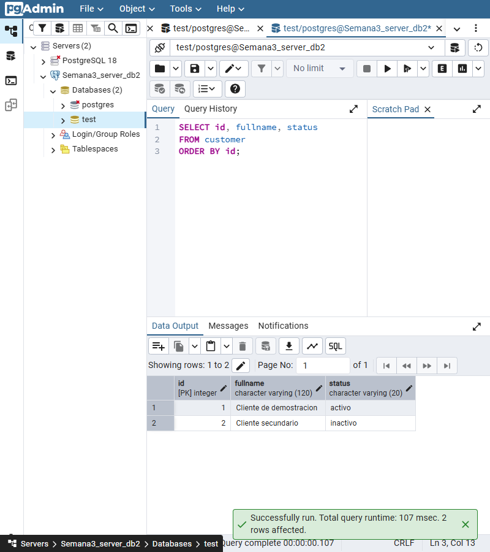
<figcaption>Figura 16. SELECT real en pgAdmin 4: los dos clientes siguen en server_db2.</figcaption>
</figure>

<figure>
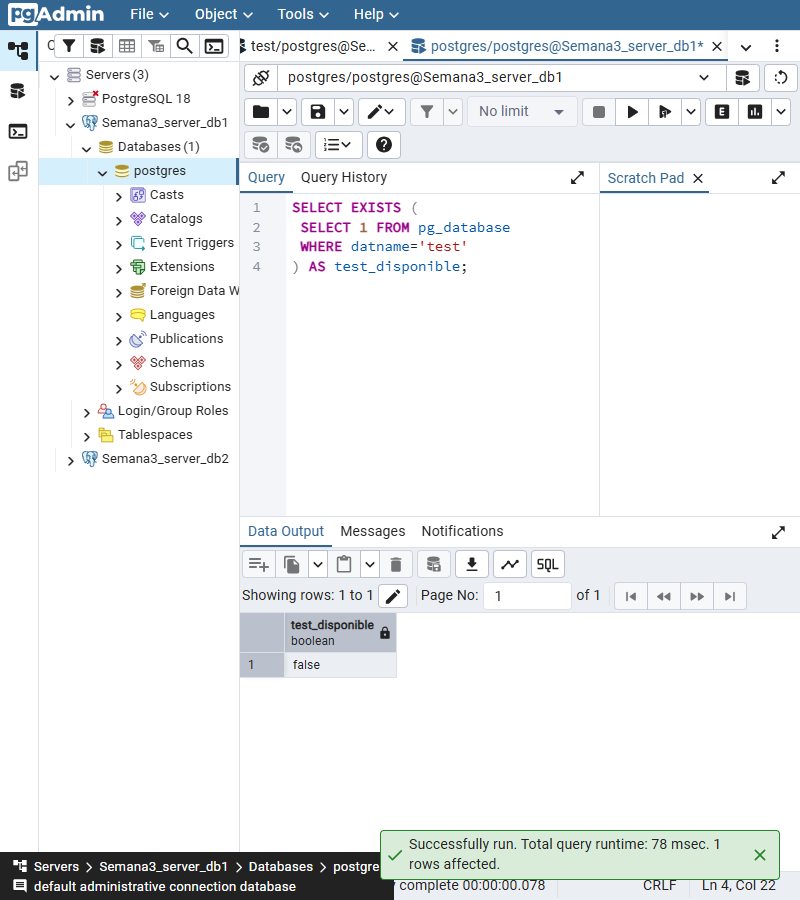
<figcaption>Figura 17. Consulta real en pgAdmin 4: test_disponible es false en server_db1.</figcaption>
</figure>

## 9. Resultados esperados

Los resultados esperados se contrastaron con consultas reales y coincidieron con lo observado:

| Comprobación | Sin reutilizar almacenamiento (`server_db1`) | Con volumen persistente (`server_db2`) |
|---|---|---|
| Base `test` y tabla `customer` antes de eliminar | Creadas, con dos filas | Creadas, con dos filas |
| Contenedor después de recrear | Identificador distinto | Identificador distinto |
| Montaje de datos | Otro volumen anónimo | El mismo `pgdata` |
| `test_disponible` al final | `f` | `t` |
| SELECT final de clientes | No puede conectarse a `test`, porque no está en el almacenamiento nuevo | Recupera las dos filas originales |
| Volumen anterior | Sigue existiendo, sin reutilizarse | Sigue disponible y montado |

El SELECT final de `server_db2` devolvió:

| id | fullname | status |
|---:|---|---|
| 1 | Cliente de demostracion | activo |
| 2 | Cliente secundario | inactivo |

La primera prueba **no demuestra la destrucción física de todos los datos**: se verificó que el volumen anónimo anterior permanece, pero la nueva instancia no lo monta. La segunda prueba sí demuestra persistencia accesible al volver a montar el mismo volumen. Los identificadores de clúster fueron distintos en los dos contenedores de la primera prueba y permanecieron iguales en la segunda.

| Recurso | Antes | Después |
|---|---|---|
| Contenedor server_db1 | `417ba5fb5b85` | `ca47c786982c` |
| Clúster server_db1 | `7701167819844685863` | `7701167884689227814` |
| Contenedor server_db2 | `08e1a4a1f0cc` | `d658bf99887f` |
| Clúster server_db2 | `7701166918810390566` | `7701166918810390566` |

Las siete comprobaciones de [resultados.json](evidencias/resultados.json) finalizaron correctamente. Ambos contenedores quedan activos en sus puertos locales y el volumen `pgdata` se conserva. Los registros anteriores de otros contenedores también se conservaron.

Aprendí que conservar el nombre de un contenedor no recupera automáticamente su base. Lo que permitió recuperar `test.customer` fue volver a montar el almacenamiento correcto. También comprobé que una captura necesita el contexto del comando y que conviene acompañarla con una salida de texto y consultas verificables.

## 10. Bibliografía

Docker Official Images. (s. f.). *postgres: Docker Official Image*. Docker Hub. https://hub.docker.com/_/postgres

Docker. (s. f.-a). *Docker Desktop WSL 2 backend on Windows*. Docker Docs. https://docs.docker.com/desktop/features/wsl/

Docker. (s. f.-b). *docker container rm*. Docker Docs. https://docs.docker.com/reference/cli/docker/container/rm/

Docker. (s. f.-c). *Volumes*. Docker Docs. https://docs.docker.com/engine/storage/volumes/

Docker. (s. f.-d). *What is a container?* Docker Docs. https://docs.docker.com/get-started/docker-concepts/the-basics/what-is-a-container/

Docker. (s. f.-e). *What is an image?* Docker Docs. https://docs.docker.com/get-started/docker-concepts/the-basics/what-is-an-image/

maguaman2. (s. f.). *informe-tendencias: informe.md* [Plantilla de informe]. GitHub. https://github.com/maguaman2/informe-tendencias/blob/main/informe.md

pgAdmin Development Team. (s. f.). *Query Tool*. pgAdmin 4 Documentation. https://www.pgadmin.org/docs/pgadmin4/latest/query_tool.html

PostgreSQL Global Development Group. (s. f.-a). *Creating a new table*. PostgreSQL 16 Documentation. https://www.postgresql.org/docs/16/tutorial-table.html

PostgreSQL Global Development Group. (s. f.-b). *Populating a table with rows*. PostgreSQL 16 Documentation. https://www.postgresql.org/docs/16/tutorial-populate.html

PostgreSQL Global Development Group. (s. f.-c). *psql*. PostgreSQL 16 Documentation. https://www.postgresql.org/docs/16/app-psql.html

PostgreSQL Global Development Group. (s. f.-d). *Querying a table*. PostgreSQL 16 Documentation. https://www.postgresql.org/docs/16/tutorial-select.html
